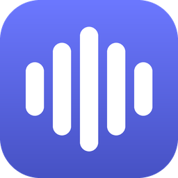

<p align="center"></p>

# Boardzz

A fast, free soundboard for Windows that can also **clip what you just heard** and turn it into a pad.

## Features

- Up to 9 tabs, each with its own 5×5 grid of pads (names + emojis)
- Crop any sound on a waveform editor (hold a handle still for 2 s to zoom in)
- Per-pad volume, emoji and name
- **Source → Boardzz → Target** pipeline:
  - **Source**: any mix of microphones, desktop audio, or a single window
  - **Boardzz**: always keeps the last N seconds (default 60) — hit *Save clip* to make it a pad
  - **Target**: where your voice and pads play (pick VB-CABLE to use it as a mic in Discord/games)
- Everything is saved in `%AppData%\Boardzz` and restored on launch
- No network code, no telemetry

## Build

Requirements: Windows 10 2004+ and the [.NET 10 SDK](https://dotnet.microsoft.com/download).

```powershell
git clone <this repo>
cd Boardzz
dotnet run
```

### Virtual microphone (optional)

To play pads into Discord or a game, Boardzz uses **VB-CABLE**. The driver pack is not stored in this repo:
download `VBCABLE_Driver_Pack45.zip` from [vb-audio.com/Cable](https://vb-audio.com/Cable/) and extract it into `vendor/VBCABLE`.
Then use **Target → Install virtual mic** inside the app.

VB-CABLE by VB-Audio (vb-cable.com). VB-CABLE is a donationware, all participations are welcome.

## Contributing

**Contributions are welcome!** Bug reports, ideas and pull requests all help.
See [CONTRIBUTING.md](CONTRIBUTING.md) for how to get started.

## Licence

[GPL-3.0](LICENSE) © 2026 Harty Prac. Uses [NAudio](https://github.com/naudio/NAudio) (MIT) and [Emoji.Wpf](https://github.com/samhocevar/emoji.wpf) (WTFPL).
